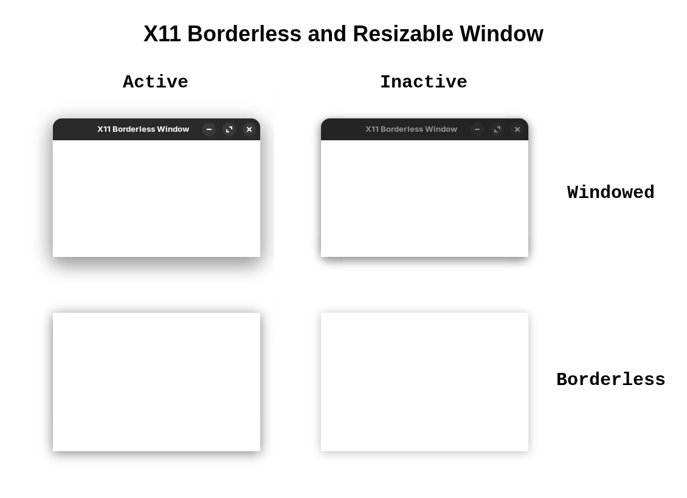

#X11 Borderless Window
================

This program is a simple example of creating a borderless and resizable window in x11  (similar to Steam and VSCode).

The borderless window can be resized, moved, and also supports all the **XWindow** features a regular window has:

- snapping to desktop halves/quadrants
- shake to minimize all other windows
- animations when minimizing, maximizing, restoring, snapping
- native soft shadow around the window

The sample should work on any linux, (No Wayland Based Window Manager).

What this example does *not* do:

- Draw anything to the client area. You will need to fill the entire window with an opaque color, or the window frame may be visible inside your client area in borderless mode. 
  In my use case I simply fill the OpenGl/Vulkan backbuffer covering the window's client area.
- Calculate proper client/window size in windowed mode. You will need to use [XGetWindowAttributes](https://tronche.com/gui/x/xlib/window-information/XGetWindowAttributes.html) and friends to calculate the correct window size for a desired client area size.

Keybinds:

- ESC        Close Window
- SPACE   Close Window
- B             (Enables/Disables) Windowed or Borderless Window
- R             (Enables/Disables) Resizing and Dragging the Borderless Window
